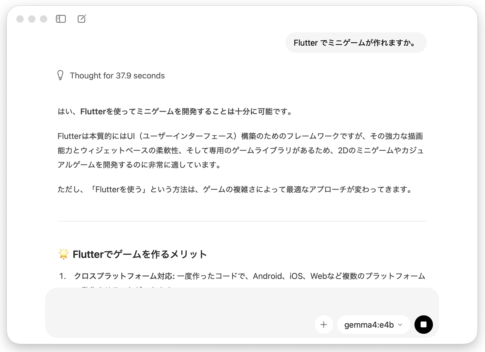
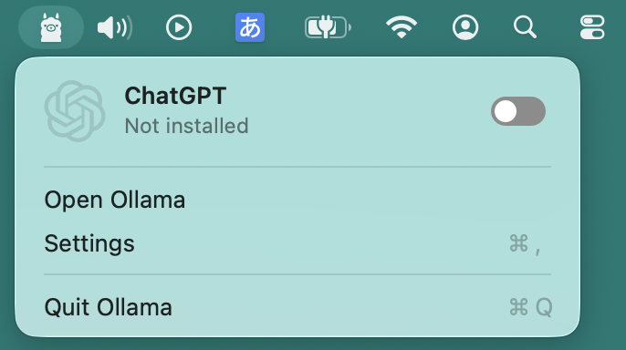
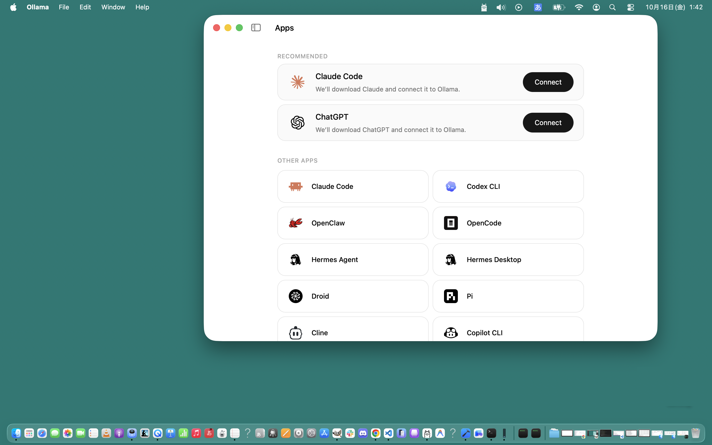
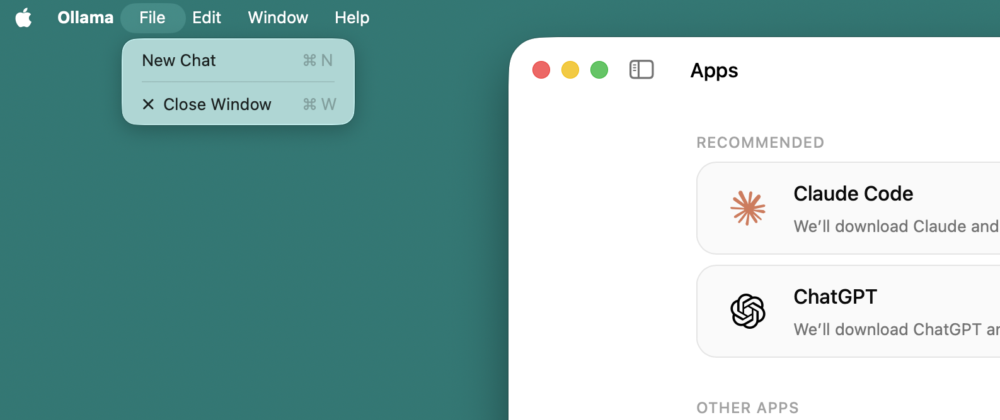
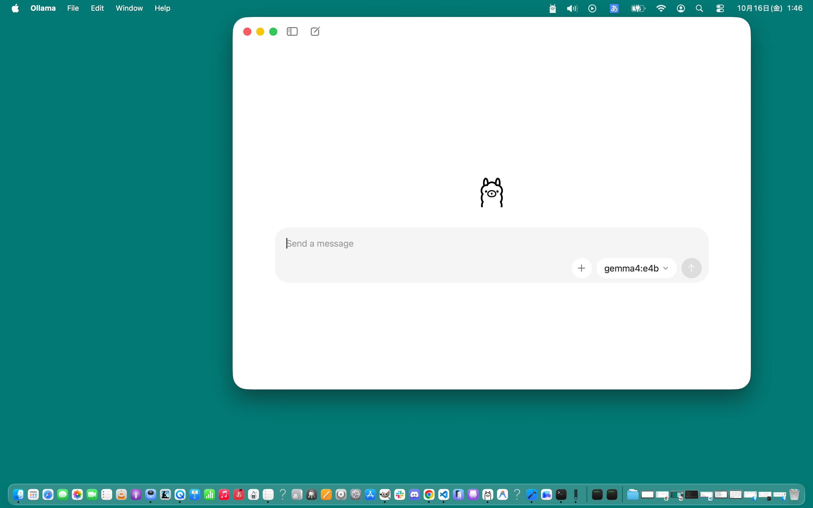
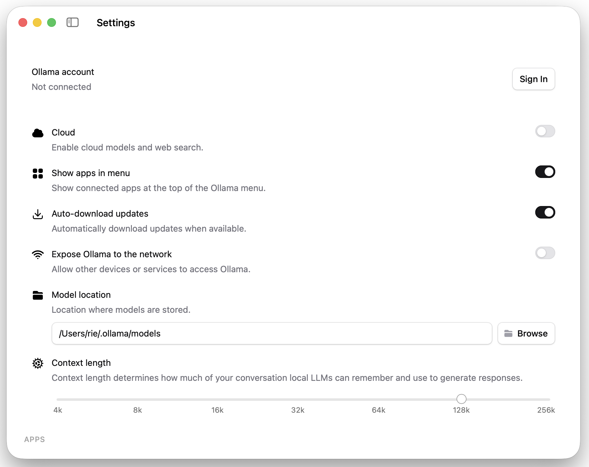
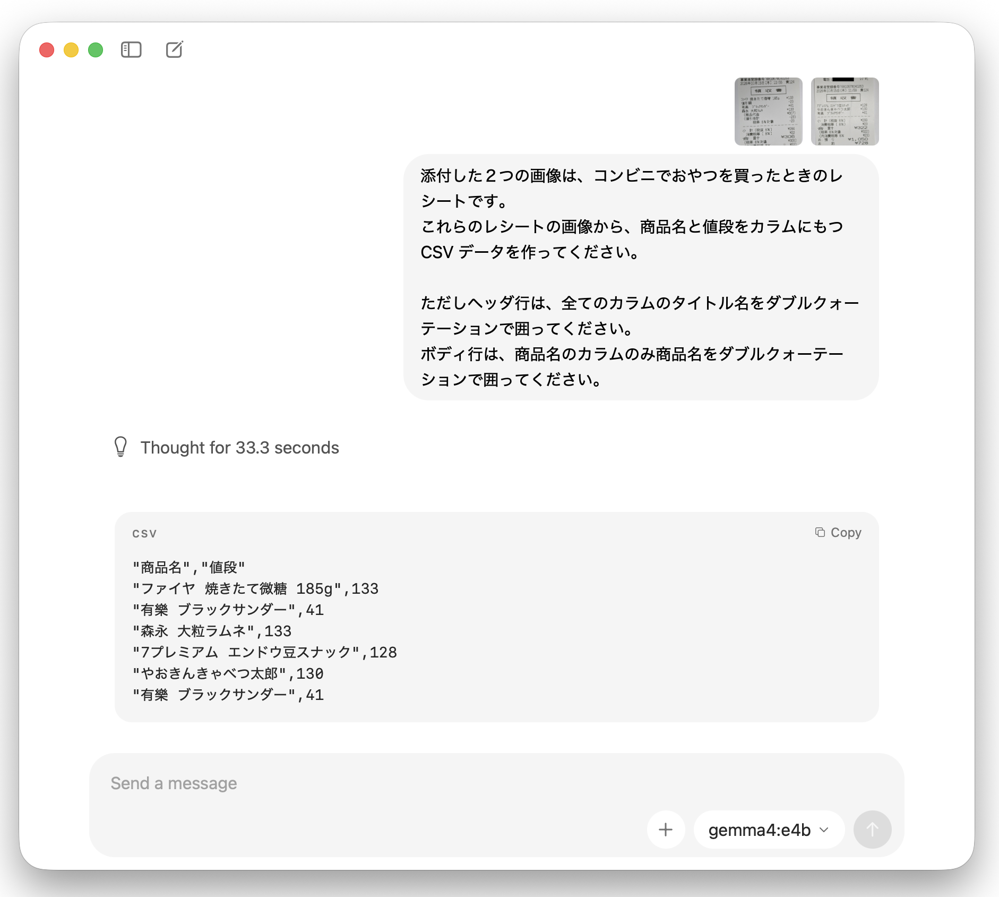

# Ollama ガイド（簡易版）

### 概要説明

* **Ollama とは**: Gemma 3/4、Llama 3 などのオープンウェイトLLMをローカルPC上で手軽にダウンロード・実行できるランタイムです。  
* **Ollama 自体は、[OpenAI互換のAPI](https://docs.ollama.com/api/openai-compatibility)エンドポイントやチャット機能を提供** しますが、コーディングエージェントではありません。
* **Ollama は、** コーディング エージェントのために ローカル LLM をホストするプロバイダになれます。  
  これにより AI サブスクリプションや API キーによる利用制限を気にせず、ローカル完結で [opencode](https://github.com/anomalyco/opencode) や [Hermes Agent](https://hermes-agent.nousresearch.com/)や [Crush](https://github.com/charmbracelet/crush)などのコーディング エージェントが利用できるようになります。  
  _ただし本格的にコーディングエージェントを使うのであれば、GPU や VRAM と共有可能な大容量(64GB〜)のユニファイドメモリなどを備えたハイエンドの PC環境が必要になります。_

---

### Ollama デスクトップアプリ

* Ollama は、ターミナル上で CLI（Command Line Interface）と TUI（Text User Interface）が使えますが、
  macOS や Windows 環境では、Ollama デスクトップアプリによる GUI設定やチャット機能も提供されています。  
  _ワークショップの環境設定で、事前に Gemma 4:e4b をダウンロード済みであることを前提に説明しているとに留意ください。_

### GUI チャット機能を使ってみる。

1. Ollamaが常駐しているとメニューバーに Ollamaアイコンが表示されています。（左端のアイコン）
   

2. メニューバーの Ollamaアイコンをマウスカーソルでタップしてメニューを表示して、
   

3. ポップアップされたメニューから "Open Ollama" を選択すると Ollama デスクトップアプリが起動します。
   

4. メニューバーの Ollama メニューの File をタップして開いたメニューから　"New Chat" を選択すると...
   

5. Ollama デスクトップアプリの表示がチャットモードに切り替わります。
   

5. ちなみに 2 のポップアップメニューで ”Settings” を選択すると Ollama デスクトップアプリは設定モードになります。
     
  - 設定モードでは、画面のようなデフォルトの設定① のままで構いませんが、Context length のみ Gemma4:e4b のコンテキストサイズの 128K に修正してください。
  - ①Cloud: OFF, Show apps in menu: ON, Auto-download updates: ON, Expose Ollama to the network: OFF, Model location: (デフォルト設定 ⇒ `~/.ollama/models`) 
  - Gemma 4 の特徴や Gemma4:e4b 以外のコンテキストサイズなどについては、[Ollama ｰ gemma4](https://ollama.com/library/gemma4) ページを参照ください。

### 補足：Gemma4:e4b は、画像認識（マルチモーダル）にも対応しています。

* *Gemma 4:e4b は、モデルサイズも小さいため知識量も限られていますが画像認識（物体認識、OCR（文字読み取り）、図表・手書き文字の解析）機能を備えています。
  - これを使えばレシートを読み取って、お小遣い帳の手伝いをさせることもできるでしょう。
      
    - [レシート１画像](images/ollama-guide/Ollama_step_11-receipt_1.png)
    - [レシート２画像](images/ollama-guide/Ollama_step_11-receipt_1.png)

