# [DevFest Kyoto 2026 - 東京出張所](https://gdgkyoto.connpass.com/event/408828/)

## AI × Flutter ミニアプリ開発ワークショップ

このワークショップでは、AIツールおよびエージェントを活用してFlutterミニアプリの開発を体験してもらうことを通じて、

AI コーディングエージェントの進化や、ローカル AI コーディングエージェントに触れていただく趣向となっています。

既に、Calude Code や Codex および Antigravity を使ってアプリ開発を実践されている方にとっては、入門 レベルと存じますが。

2026年の AI コーディングの一端を体験していただければ幸いです。

---

- ワークショップでは、Google アカウントを使った Gemini 無料枠を利用します。  
  ワークショップに関心を持った方々に幅広く参加していただけるよう、Google アカウントの Gemini 無料枠を利用します。  
  参加者ご自身の Google アカウントを使いますが、AI利用のためだけの新規アカウント作成やクレジットカード登録は不要です。

  - Google アカウントの [Gemini 無料枠には、利用可能モデルや使用量制限がある](https://support.google.com/gemini/answer/17004136?hl=ja&sjid=9846380269382269129-NC)ことに注意してください。  
    ①無料枠で使えるモデルは、Gemini Flash-Lite のみです。  
    ②無料枠の使用量上限のリセットは週単位です。（**上限になれば翌週まで使えません**）  
    ③無料枠のコンテキストサイズは、1M(100万)トークンです。（推論力に制限があります）  
    ④プロンプトの複雑度や会話の長さにより使用量の消費が増大します。  

  - Antigravity 無料枠と Gemini web Apps 無料枠は分かれています。  
    このため Antigravity 無料枠の上限になっても、Gemini Web Apps は利用できます。  
    **無料枠の方は、ワークショプ前の数日間の Anitigravity 利用を控えていただくよう願います。**

_本ドキュメントは、Geminiを使って調査｜生成されたドキュメントをベースに作成しました。_

---
---

## はじめに

このワークショップは、Antigravityで ミニゲームの Flutter アプリの作成を体験してもらうため、  
[ワークショップ 環境設定ガイド](https://cch-robo.github.io/DevFest_Kyoto_2026-Tokyo_sub_office/devfest_kyoto_workshop_guilde_2026_fall.html)を参照して、
Flutter 開発環境と Antigravity CLI および Ollama と Crush をインストールされていると思います。

以下のコマンドで、これからゲームアプリを作らせるワークショップのリポジトリをクローンしてください。

`git clone git@github.com:cch-robo/DevFest_Kyoto_2026-Tokyo_sub_office.git`

_git を使えない方は、こちらから [zip ](https://github.com/cch-robo/DevFest_Kyoto_2026-Tokyo_sub_office/archive/refs/heads/main.zip) ファイルを取得して、都合良いところに展開してください。_


- DevFest Kyoto 2026 - 東京出張所 ワークショップの GitHubリポジトリ  
  https://github.com/cch-robo/DevFest_Kyoto_2026-Tokyo_sub_office  


### Antigravity ワークスペースの作成

ワークショップのりポジ取りをクローンされた方は、
`step_1/handson_agy` ディレクトリを使えば、ワークショップの Antigravity ワークスペースとして利用できます。

もしも手動で任意の場所にワークスペースを作りたい場合は、ターミナルで以下のコマンドを実行してください。

```bash
# 任意の場所に handson_agy ディレクトリを作成。
makdir handson_agy
cd handson_agy

# 空の AGENTS.md ファイルと .agents/ ディレクトリを作成する。
touch AGENTS.md 
mkdir .agents/
```

_Antigravity ワークスペースは、空ディレクトリであっても構いません。_

---
---

### Antigravity を使い始める。

#### Antigravity へのサインインと利用規約への同意＋ワークスペース信任の確認

- step.1  
  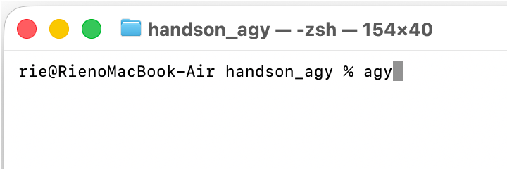  
  ターミナルを開き、ワークスペースディレクトリに移動してから、`agy` コマンドを実行して Antigravity CLI を起動します。

- step.2  
  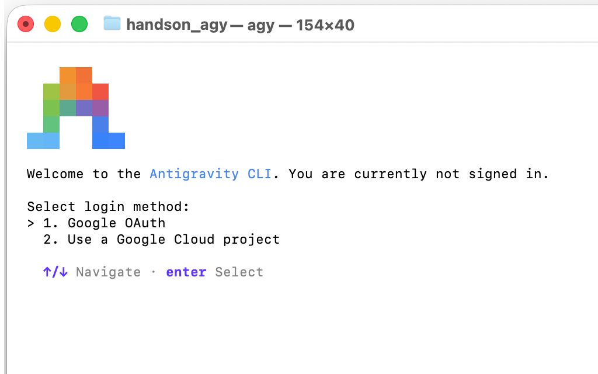
  Antigravity CLI の初回起動時は、Antigravity にサインインしていないのでログインが求められます。  
  ここでは、Google OAuth を選択して Enter を入力してください。

- step.3  
  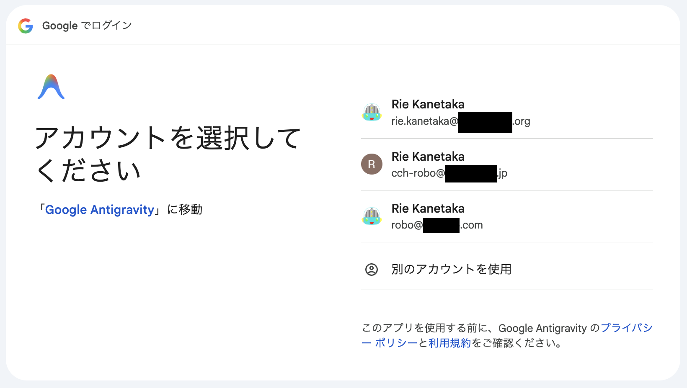  
  Chrome ブラウザが開き、ログイン可能な Google アカウントの選択が求められます。  
  _この例では、一番下の robo アカウントを利用しました。_

- step.4  
  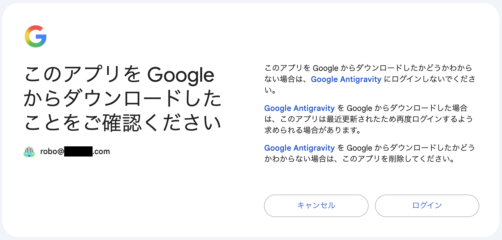  
  [ログイン] をクリックして次に進みます。  
  _ワークショップ環境設定の手順でインストールしていれば、Google からの取得になります。_

- step.5  
  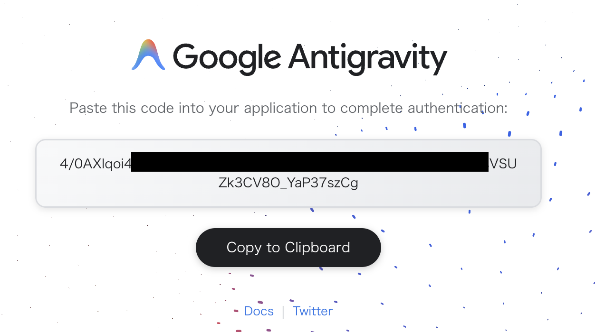  
  認証コードが表示されるので、[ Copy to Clipboard ] をクリックしてクリップボードにコピーします。

- step.6  
  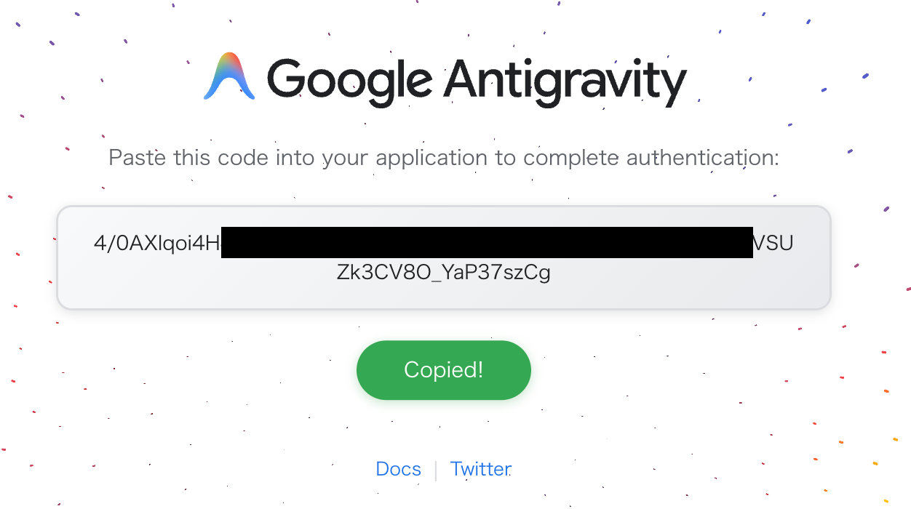  
  認証コードがクリップボードにコピーされるとボタンが緑色の [ Copied! ] に変化します。  
  _認証コードをコピーしたのでブラウザ画面を閉じても構いません。_

- step.7  
  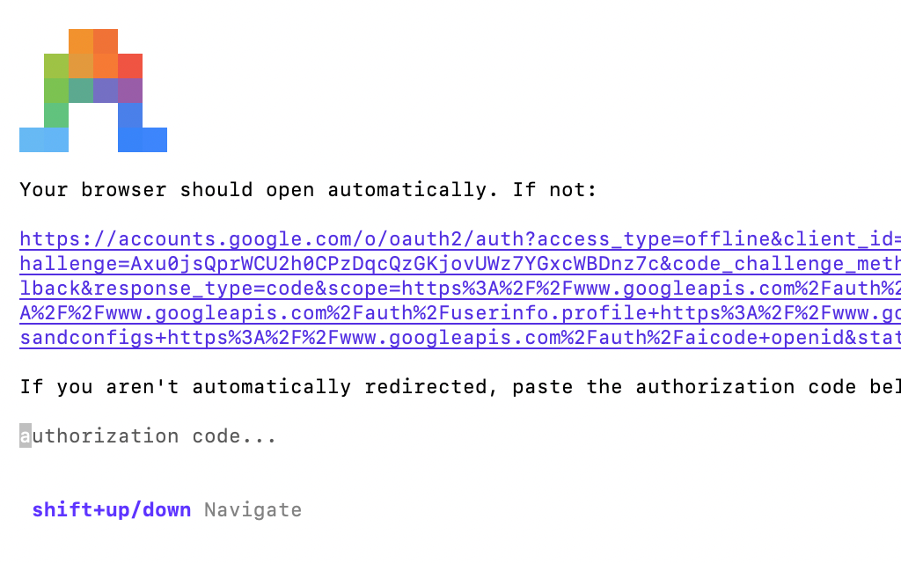  
  ターミナルに戻ると、画面が上記のように変化しています。  
  `authorization code...` と灰色で表示されている箇所に、Ctrl+V で認証コードをペーストします。

- step.8  
  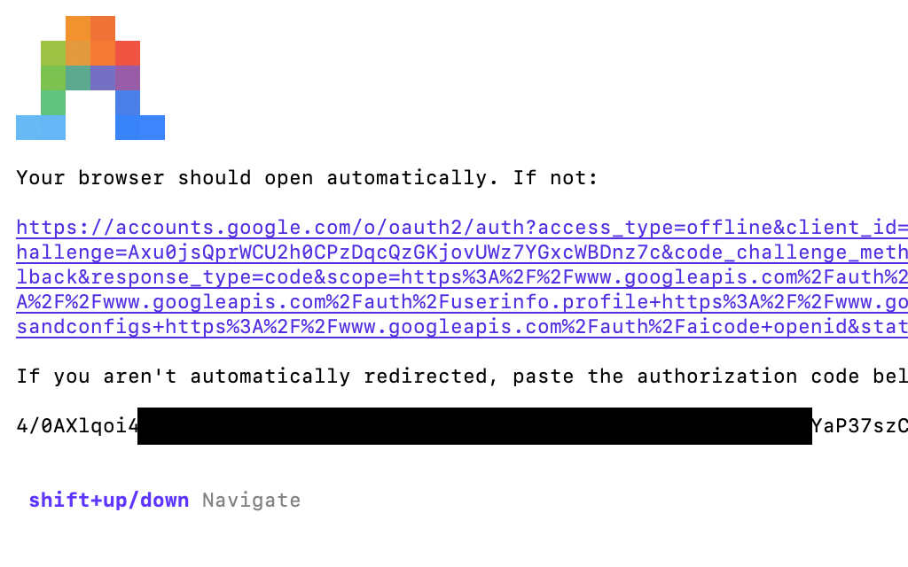  
 `authorization code...` に認証コードがペーストされると認証が始まります。
 
- step.9  
  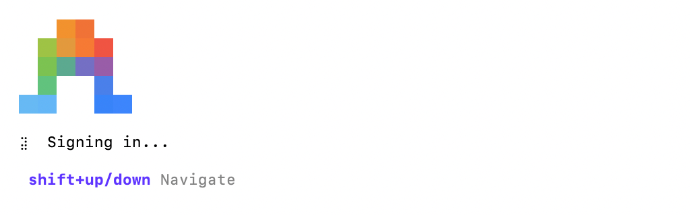  
 サインイン認証中...

- step.10  
  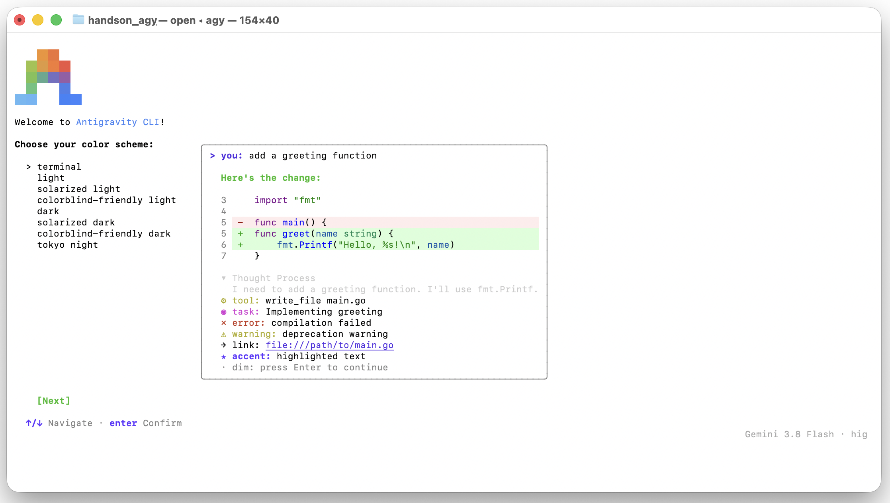  
  認証が通るとカラースキームの選択になるのでお好きな色を選択して、[ Next] で次に進んでてください。

- step.11  
  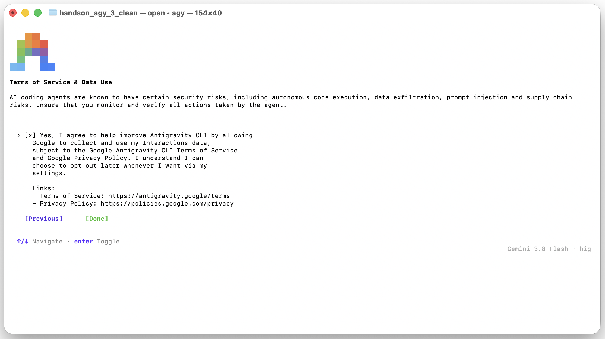  
  利用規約への同意にチェック `[x]`を入れて `[Done]`を選択して Eneterを入力します。

- ここで同意確認されていること。  
  - AIコーディングエージェントにはセキュリティリスクがあるため自らが注意義務を持ちます。
  - Google Antigravity CLI 利用規約および Google プライバシーポリシーに従ったユーザーのプロンプト入力や出力（インタラクションデータ）の収集に同意します。
  - _このデータ収集設定は、以下の操作でオプトアウト（利用停止）に変更できます。_
    1. Antigravity CLI を起動します。
    2. `/config` を入力して設定メニュー（Preferences）を開きます。
    3. 設定項目の中から **Enable Telemetry** を選択し、設定を OFF に切り替えます。


### Antigravity ワークスペース信任の確認

- step.12  
  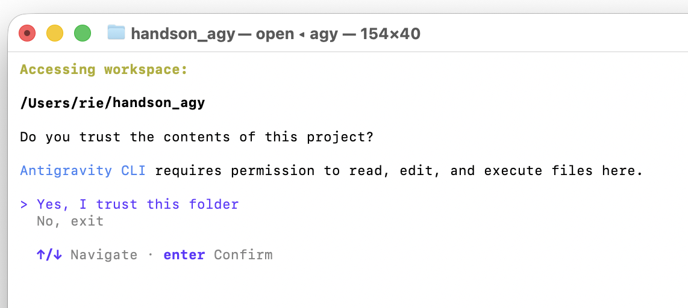  
  AI コーディングによりファイルの更新や実行が発生するので、ワークスペースが信頼できるか確認されます。  
  信頼できるワークスペースであることを表明するため `Yes, I trust this folder` を選択して Enter を押下します。

指定の Google アカウントでの Antigravity へのサインインと利用規約への同意＋ワークスペースの信任が確認されたのでこの章は終わりです。


---
---


## ミニゲームの生成

この章では、ミニゲームとしてブロック崩しゲームを生成してもらうため、皆さんに15分ほどのお時間を提供します。

このあとの入力プロンプトと、Antigravity CLI からユーザへの許可｜`allow` 確認の対応を行って、ご自身でゲームを生成させてください。


- 補足：ブロック崩しゲームは、ボールの壁やブロックでの反射や パドルとボールとの相対速度により反射角度が変わります。  
  これは簡易ながら物理演算があり、地味に手間がかかることを意識してください。


### ブロック崩しゲーム生成のためのプロンプト入力

- step.1  
  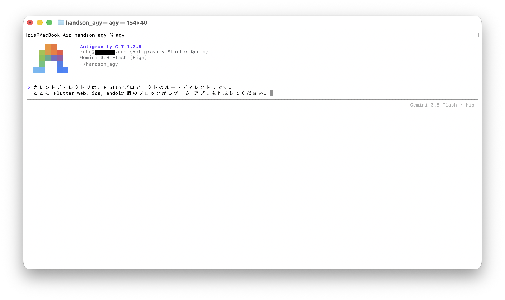  
  **”カレントディレクトリは、Flutter プロジェクトのルートディレクトリです。
  ここに Flutter web, ios, android 版のブロック崩しゲーム アプリを生成してください。”**  
  ...以上を入力して Enter を押下してください。  

  - プロンプト入力は、これだけで完了です。  
    2026年のフロンティアモデルは、概念が確立しているようなアプリであれば、一般的なコードやプロジェクトを学習済みなので、指定がなければ一般的な解答を生成するように思えます。


### Antigravity からユーザへの許可確認の対応パターン

Antigravity からユーザに対して、コマンドやツールの利用やコードファイルの更新許可が求められます。  
基本的に、許可｜`allow`で良いのですが、どんなパターンがあるのか見ておいてください。

- step.2  
  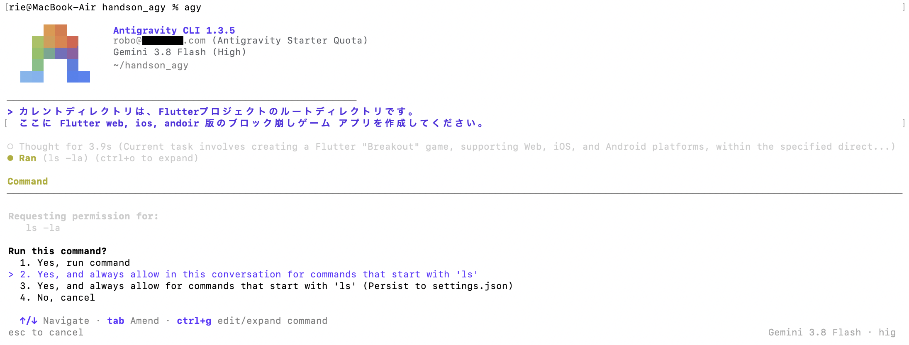  
  ここでは、プロジェクト内の実装状況 ⇒ コードファイルツリーを調べるため、`ls -ls` コマンドの実行許可を求めているようなので許可を与えますが、  
  これら調査のためのツールやコマンドの実行はこれからも発生するので、 **Yes, and always allow in this conversation for command that satrt with `ls`** を選ぶようにします。  
  ワークショップには時間的な制限があるので、このような都度ごとの `allow` と `会話（セッション）単位での allow` があれば後者を選んでください。

- step.3  
  
  コードファイルの生成（コード生成）の許可を求められましたら、基本的に `allow` を選択してください。

- step.4  
  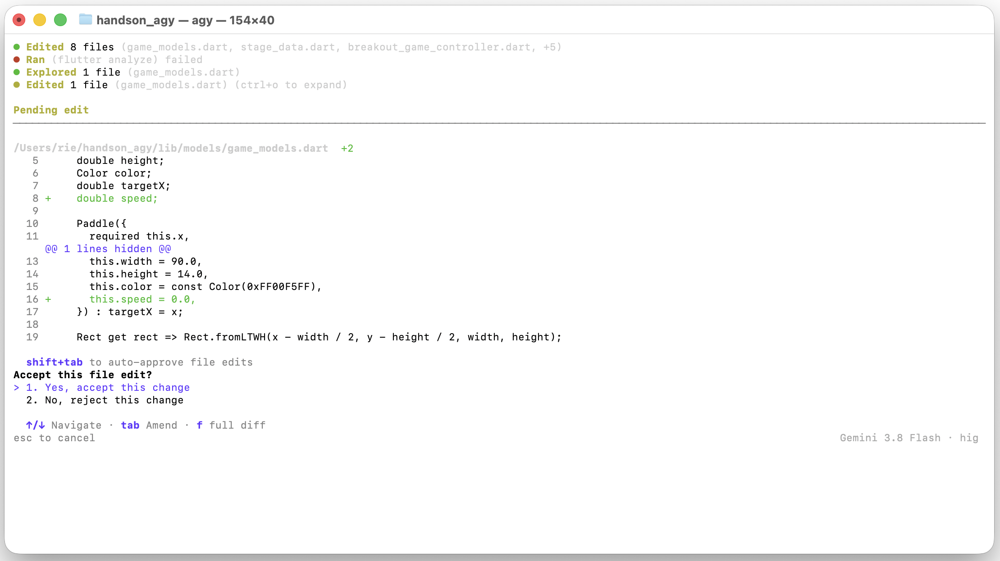
  コードファイルの修正（コード修正）の許可を求められましたら、基本的に `allow` を選択してください。

- step.5  
  
  同じくコードファイルの修正（コード削除）の許可を求められましたら、基本的に `allow` を選択してください。

- step.6  
  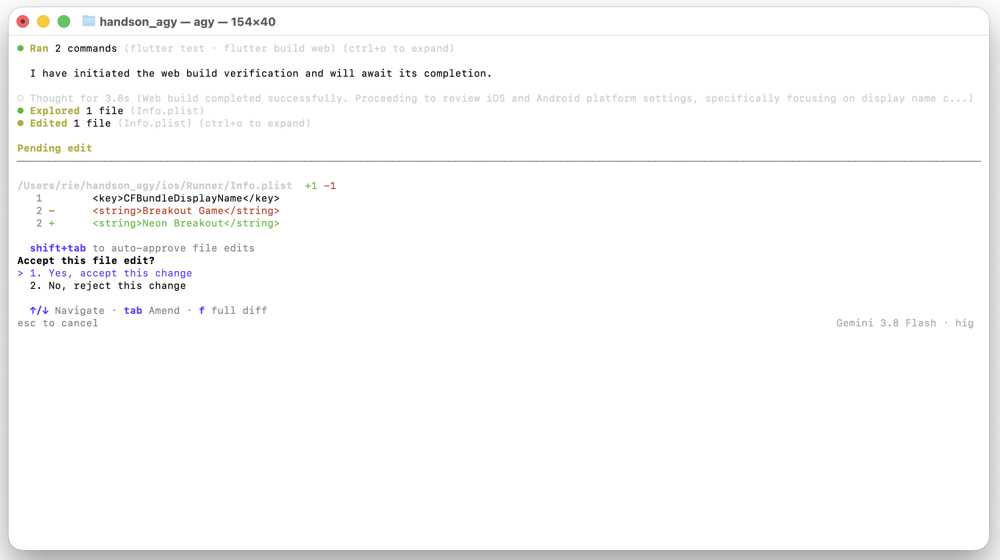
  iOSのコードファイルの修正（コード修正）の許可を求められましたら、基本的に `allow` を選択してください。

- step.7  
  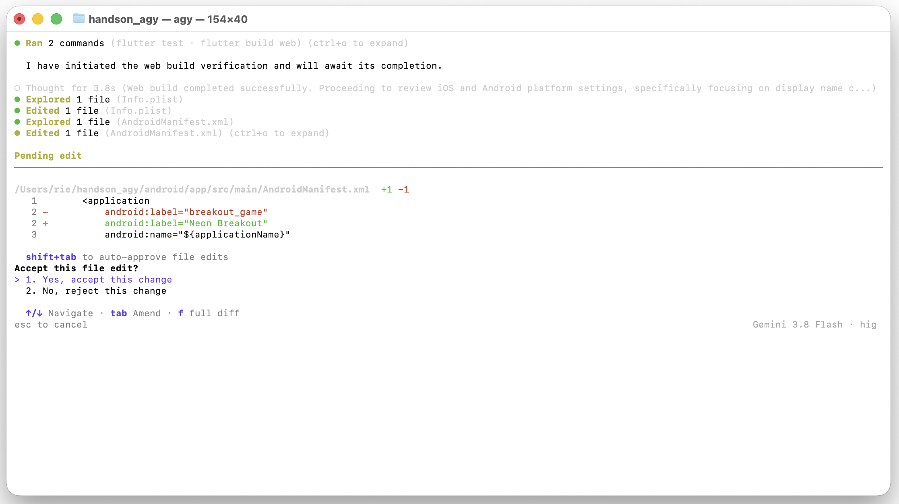
  Androidのコードファイルの修正（コード修正）の許可を求められましたら、基本的に `allow` を選択してください。

- step.8  
  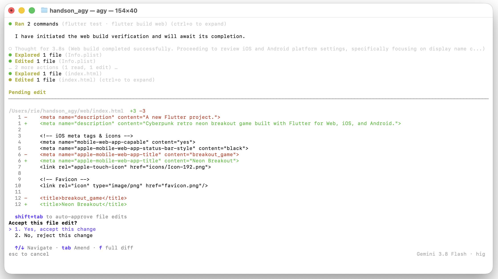
  webのコードファイルの修正（コード修正）の許可を求められましたら、基本的に `allow` を選択してください。

- step.9  
  
  コード検証（`flutter analyze` や `flutter test`コマンドの実行）の許可が求められましたら、  
  ワークショップには時間的な制限があるので、このような都度ごとの `Aalow` と `会話（セッション）単位での allow` があれば後者を選んでください。

- 何度も繰り返しましたが、許可の確認がありましたら「何をしているのか」を一度見てから `allow` してください。  
  許可｜`allow`を求めるにも以上のようなパターンがあり、黙々とコードを生成するのでなく、試行錯誤しながらアプリを作っていることがわかると思います。

  - コード検証の許可を求められれば、アプリは完成に近づいています。


### ゲームアプリの完成報告

おそらく 15分ほどで、Antigravity はゲーム アプリの完成を報告すると思います。

- step.10  
  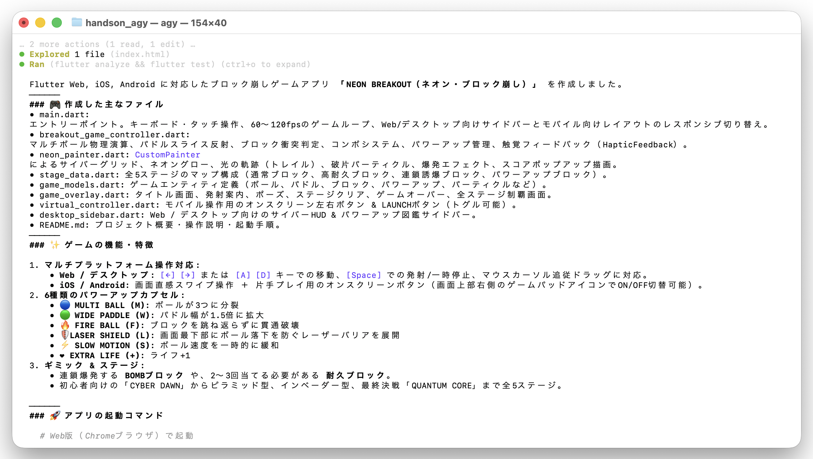  


- step.11  
  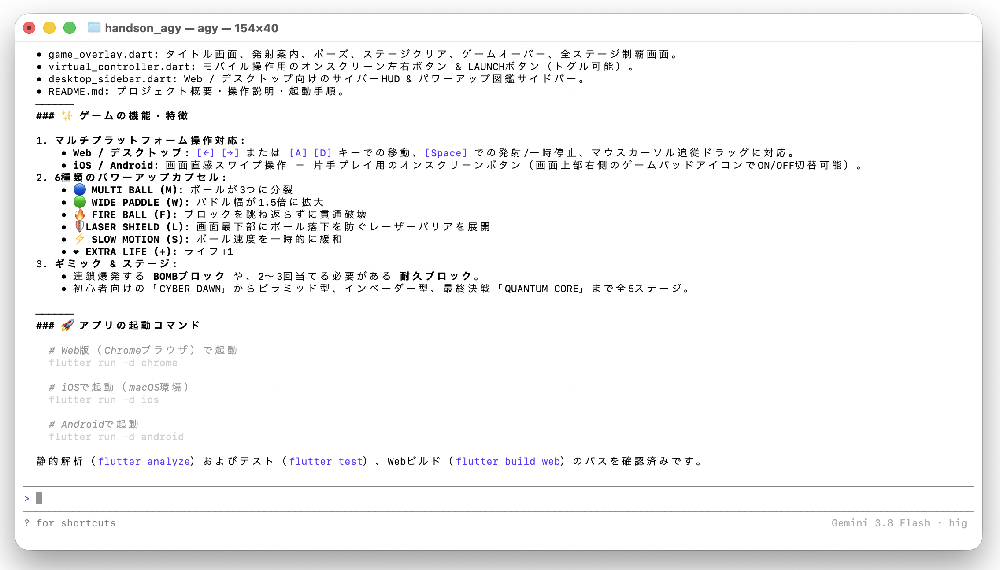

- メッセージ末尾に、ゲームをプレイするためのコマンドが紹介されていますね。
  - web版 : `flutter run -d chrome`
  - iOS版 : `flutter run -d ios`
  - android版 : `flutter run -d android`

### Antigravity 終了

ゲーム アプリが完成したので、Antigravity を終了させておきましょう。

- step.12  
  
  Antigravity との会話を終了させるには、`/quit` または　`/exit` コマンドを実行します。

---
---

## ブロック崩しゲーム アプリをプレイしてみよう

Antigravity CLI を終了させたターミナルのカレントディレクトリは、Antigravity ワークスペースのルートディレクトリであり、Flutter プロジェクトのルートディレクトリでもあります。

このためゲームアプリを起動するのは、`flutter run -d chrome` コマンドを実行するだけです。

上記のコマンドの実行により、Chorme ブラウザが起動してブロック崩しゲームが始まります。  
_みなさんに 5分から10分ほどの時間を提供しますので。どんなゲームができたのかチェックしてみてください。_


- step.1  
  ブロック崩しゲーム起動  
  _**生成アプリごとに画面構成が異なることに注意！**_

  

- step.2  
  ゲームプレイ開始

  

- step.3  
  ゲームプレイ中

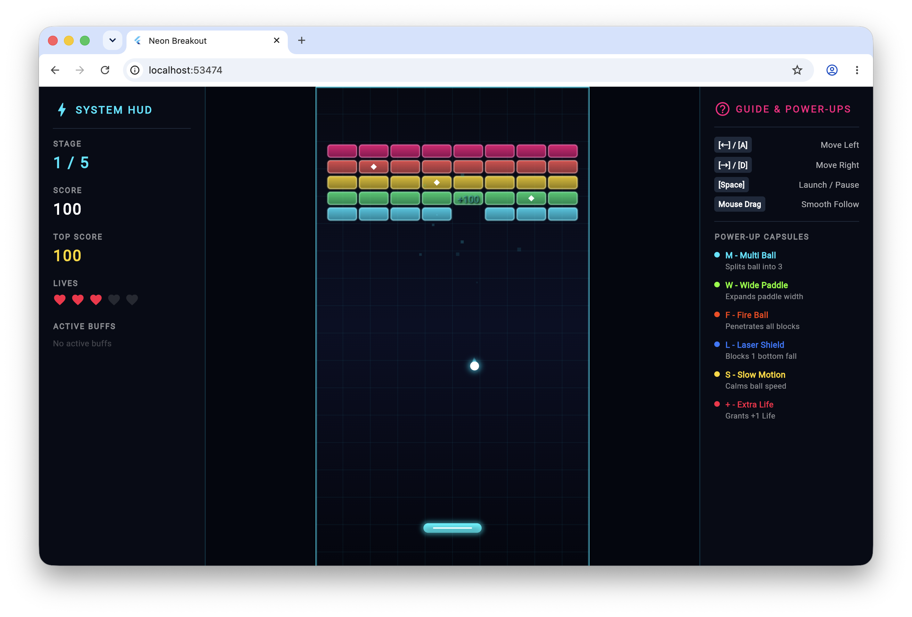  

 - step.6  
   **[NEON BREAKOUT ゲーム動画](https://cch-robo.github.io/DevFest_Kyoto_2026-Tokyo_sub_office/images/agy_cli_launch_breakout/launch_game_step_6.mov)**

 - step.6  
   **[NEON BREAKOUT ゲーム動画](./images/agy_cli_launch_breakout/launch_game_step_6.mov)**


### ゲームアプリが完成しなかった方へ

`step_2.handson_agy/`ディレクトリに、私の環境で Antigravity が生成したゲーム アプリを配置しました。

Antigravity でアプリが作成されたがバグが発生していたり、無料枠のトークンが切れてしまった方は、こちらのアプリを試してみてください。

---
---

## 残された課題

一般的な実装やプロジェクトが公開されているプロダクトであれば、”作って” と依頼するだけでアプリが作れる時代になったようです。

エンジニアがいなくてもアプリは作れると思われた方もいると思いますので、

楽しいゲームアプリの時間を少し分けてもらって、ここで落とし穴を紹介したいと思います。


### トークンは貴重な資源

皆さんに黙っていて申し訳ないのですが、Antigravity には、トークン使用量（残量）を表示する `/usage` コマンドがあります。

またどの Gemini モデルをどれぐらい考えされるのかを設定｜確認する `/model` コマンドもあります。

Antigravity はデフォルトで Gemini 3.8 Flash ｰ high モードが指定されていてスペックは高めです。(2026/10/10調べ)

- step.1  
  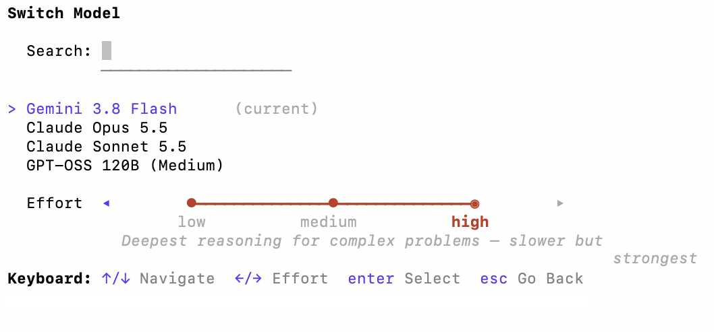

私が試した限りですが、ゲームアプリ生成のため 15分間の間、Gemini 3.8 Flash - high を稼働させると、無料枠の約半分を消費することがわかりました。

#### ゲームアプリ 生成前（無料枠 100%残存）

- step.2  
  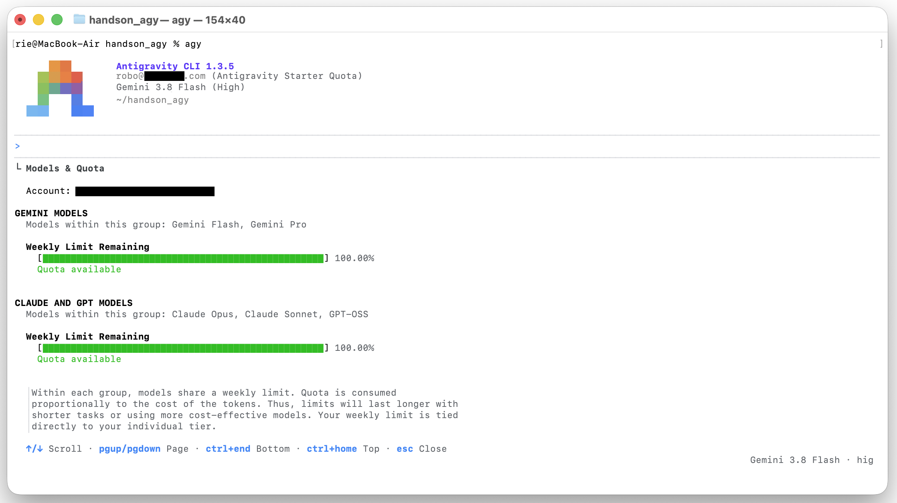  
  `/usage` コマンドで無料枠残量を確認

#### ゲームアプリ 生成後 - 15分後（無料枠 54%残）

- step.3  
  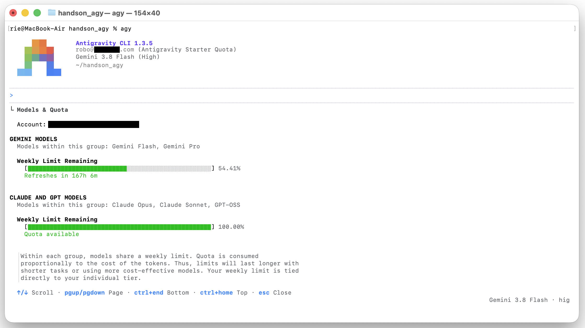
  `/usage` コマンドで無料枠残量を確認


Antigravity 使用量は推論負荷に依存するので、ハイスペックのモデルを使うとそれだけトークン消費が激しくなります。

とはいえスペックが低いとアプリを完成しきる確率も減るのでスペックを上げざるを得ないことを了承ください。

**ワークショップで、これ以上 Antigravity を使うと翌週まで利用はお預けになる可能性が高くなります。**

_これは「無料枠における制限」でなく、**AI に推論させるにも効率を目指す必要あがる** とお考えください。_

---

### Vibe Coding のままではエンジニアリングに向かない。

同じモデル同じプロンプトでゲーム アプリを生成させても、同じアプリは作られません。

科学や技術により製品を安定した品質で再現可能にするのが **工学｜エンジニアリング** であれば、
毎回どこが異なるのかわからないのでは、信頼して作業を委任することができません。

必要なところのみ修正して作り直してもらえる**仕組み**が必要です。

#### 同じプロンプトから生成された異なるアプリ例

同じプロンプトを与えるだけでは、同じアプリが生成されるわけではありません。

- Sample.A-1  
  

- Sample.A-2  
  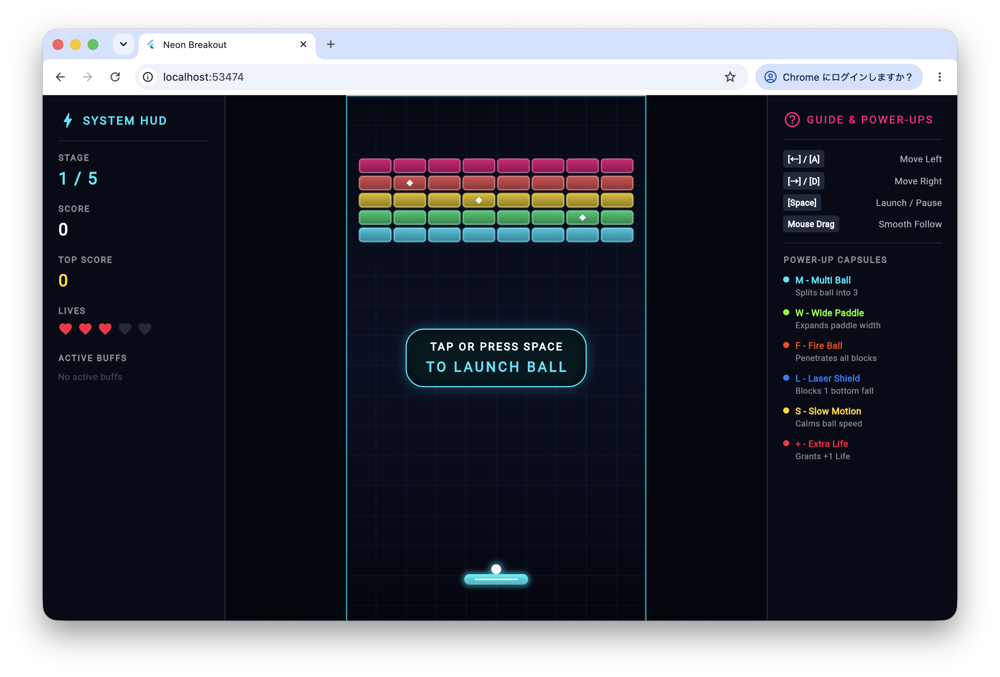

- Sample.B-1  
  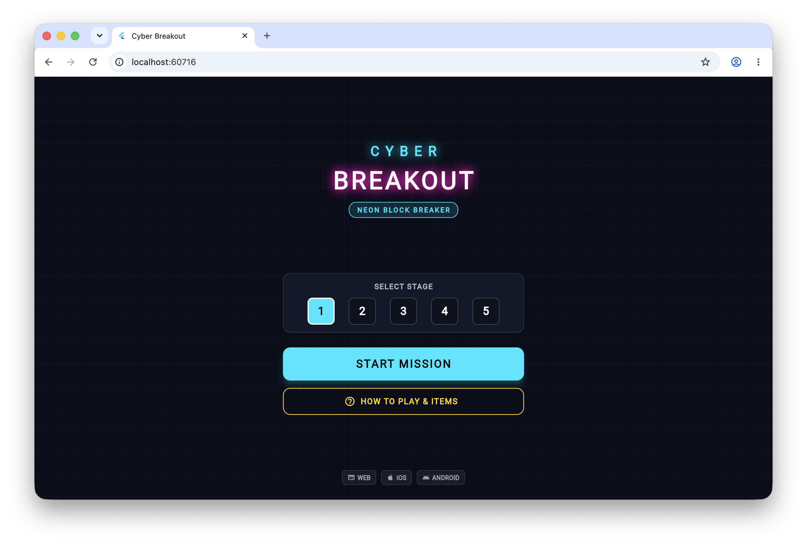

- Sample.B-2  
  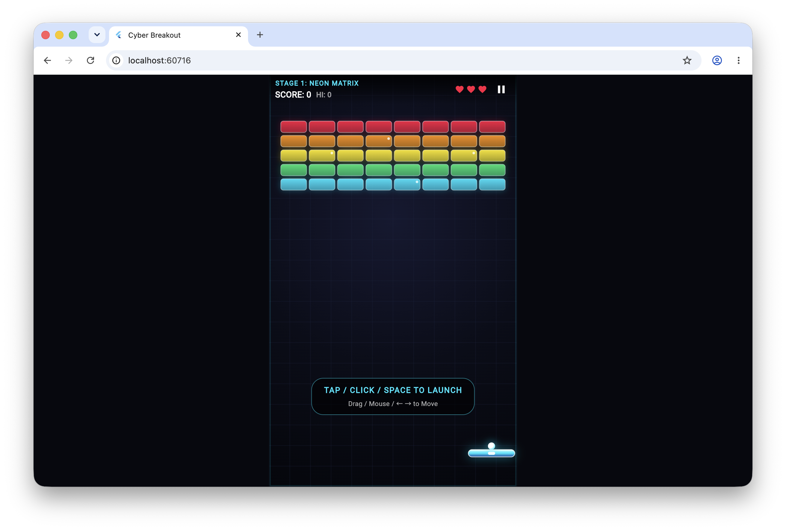

- Sample.C  
  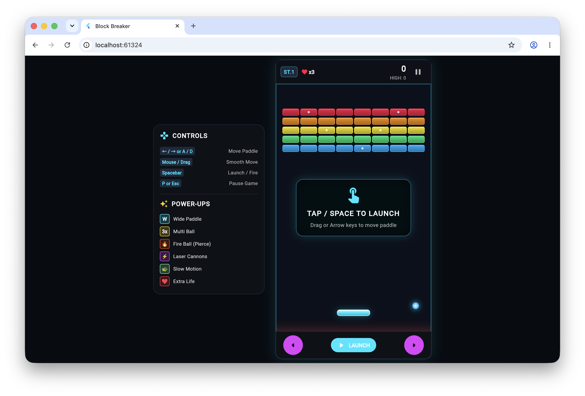

### AI に同等のアプリを作らせる方法を適用したもの

- Sample.D
  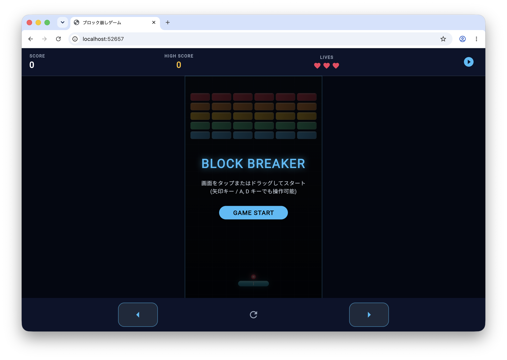

- Sample.E
  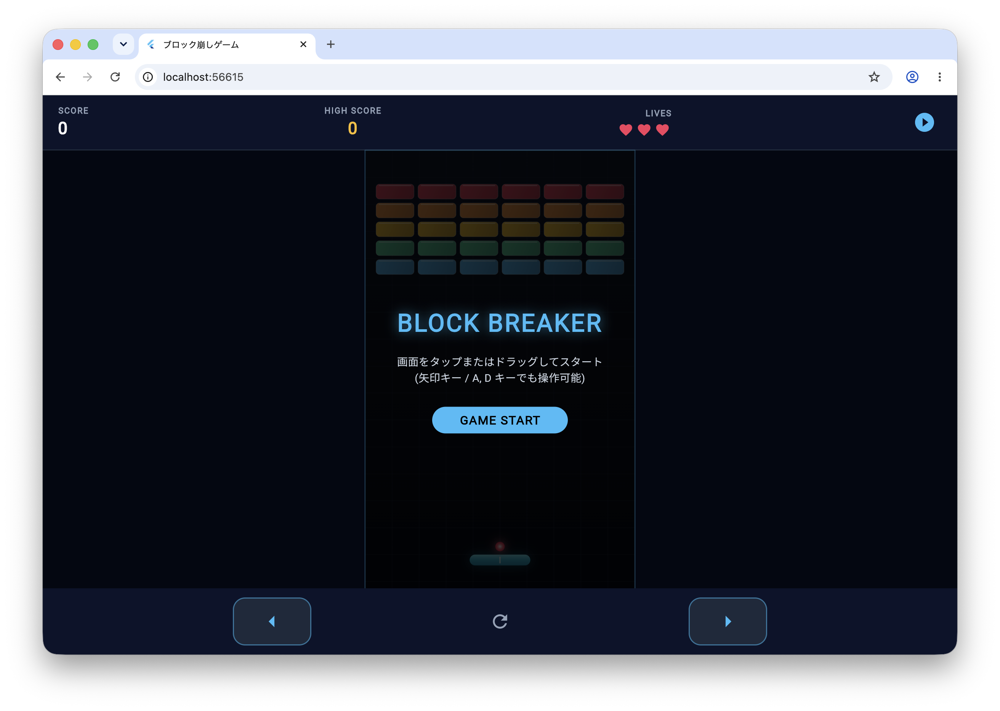

サンプル Dと Eは、AI に同等のアプリを生成させる手段を用いて、
ワークショップと同じように空のワークスペース（Flutterプロジェクト）から生成させました。

これらアプリは、クローンしたリポジトリの `step_3/`に配置していますので比較して見てください。

```
├ step_3/
│  │
│  ├ handson_agy_gemini/ Antigravity で Geminiモデルで生成させたアプリ
│  │
│  └ handson_crush_quen/ Crush ハーネスで Qwen3.8 27bモデルで生成させたアプリ
```

## 種明かし ｰ プロジェクトを再現する全体設計書と要件仕様書を作りました。

**handson_agy_gemini/** は、今回のワークショップと同じ手法で、Antigravity にブロック崩しゲーム アプリを作らせた Flutter プロジェクトです。

この生成されたコードと構成ファイル（`pubspec.yaml`や`analysis_options.yaml`）をゼロから再現できるようにする、**全体設計書** と **要件仕様書** を作りました。

**handson_crush_quen/** には、空のワークスペースに その **全体設計書** と **要件仕様書** のみを与えて、`"これらを理解してプロジェクトを完成してください"`と依頼したものだったのです。


### 1. Opus 5.5 に全体設計書と要件仕様書を定義させました。

**handson_agy_gemini/** ⇒ Antigravity ワークスペース ⇒ Flutter プロジェクトです。

Claude Code で、このプロジェクト・ディレクトリをワークスペースにして、次の手順で **全体設計書となる CLAUDE.md** と **要件仕様書となる SPECIFICATION.md** を作らせました。

1. **全体設計書｜CLAUDE.md** 
  `/iniit`コマンドを実行してアプリ全体の設計書となる **CLAUDE.md** を生成させました。

2. **要件仕様書｜SPECIFICATION.md**
  以下のプロンプトを与えて、プロジェクトを解析させ Markdown 形式の仕様書を作成させました。  
  　  
  ”カレントディレクトリは、Flutterアプリのプロジェクトディレクトリ・ルートです。  
  このプロジェクトの lib/ と test/ 配下のdartファイル、および pubspec.yaml ファイルの内容を確認してください。  
  確認したファイルの内容より、このアプリのコードを再現させる要件一覧を要件ごとに箇条書きにした Markdown ファイルを作成して  
  `./SPECIFICATION.md` ファイルとして出力してください。”


### 2. AI に全体設計書と要件仕様書を読ませて、プロジェクトを生成させました。

**handson_crush_quen/** には、空のワークスペースに前の手順で生成させた **全体設計書** と **要件仕様書** のみを与えました。

ただし多くの AI コーディング エージェントが利用できるよう、**CLAUDE.md** は **AGENTS.md** に変名しています。

3. そして、以下のような **指示プロンプト** を与えてプロジェクトを完成させました。  
  　  
  ”カレントディレクトリは、Flutter アプリのプロジェクトディレクトリ・ルートです。  
  ルート配下にある、仕様書 ./SPECIFICATION.md ファイルの要件に従って、ここに Flutter プロジェクトを作成してください。”  
  _**AGENTS.md** はシステムコンテキストとして、最初に読み出されることに留意ください。_

_上記のプロンプトは単純なため、大量の推論コストを発生させるので最適化させる工夫が必要です。_


### 3. 全体設計書と要件仕様書を使った、同等プロジェクトの完成は複数条件で成功しました。

AI に全体設計書と要件仕様書を読ませて、空ワークスペース ⇒ 空プロジェクトディレクトリから、同等プロジェクトを完成させる手法は、複数の モデル と AI コーディングエージェントで成功を確認しました。

1. Claude Code ｜ Opus 5.5
2. Antigravity CLI ｜ Gemini Flash 3.8
3. Crush coding agent harness ｜ Qwen3.8:27b （ローカルLLM）


### 4. 全体設計書と要件仕様書の全文紹介

- **[AGENTS.md](specification/AGENTS.md) 全文**

- **[SPECIFICATION.md](specification/SPECIFICATION.md) 全文**

_自然言語でプログラミングさせているようですね。_  
_これを理解して修正できるのは、エンジニアなのかもしれません。_

---
---

### 【補足】Antigarvity テクニック2026年秋版

昨年からの１年間で、AI コーディングエージェントの常識は大きく変わりました。

AI コーディングエージェントのテクニックについてまとめましたので参照下さい。

- Webコンテンツ版: [Antigarvity テクニック2026年秋版](./Antigravity_technik_2026_fall.html)

- リポジトリ版: [Antigarvity テクニック2026年秋版](./Antigravity_technik_2026_fall.md)

---
---

### 【備考】現在 Google サブスクユーザーに、Gemni 4 Argon が割り当てられています。

- (2026/10/16)`/model` 表示内容  
  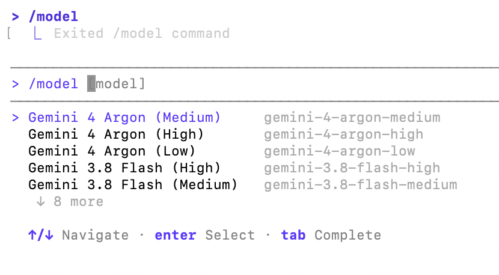

- [Google AI のプラン - 最新のフロンティア モデル Gemini 4 Argon を活用](https://one.google.com/intl/ja_jp/about/google-ai-plans/)

_ワークショップで Gemini 4 を使うとトークンを燃やし尽くすかもしれませんね。_

---
---

## ミニゲームの生成の続き

技術寄りに脱線しましたので、ミニゲーム生成に戻りましょう。

とはいえ無料枠の半分は、既に消費されています。

このまま修正を加えると、中途飯場な常態で Gemini無料枠が尽きて、動かなくなったアプリのまま翌週の再開まで我慢させられては困ります。

このため あらかじめインストールしてもらっていた、ローカルLLMを使ってみましょう。


### Crush ＋ Ollama ＋ Gemma でローカルAI開発

**step_4/handson_crush/** は、**step_1** のワークスーペースに Crush 設定ファイル `.crushrc` を追加したワークスペースです。

ターミナルでカレントディレクトリをここに移動させてから `crush` コマンドを実行してください。

- step.1  
  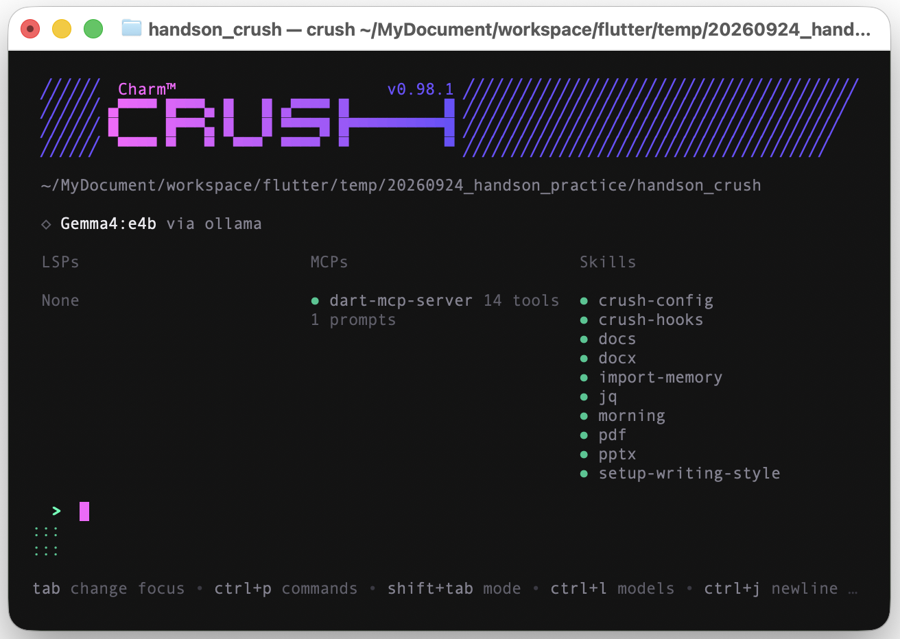  
  Crush coding agent harness が起動したところ。

- step.2  
  `/model` コマンドを実行して、`Qwen3.5:4b`モデルを選択します。

- step.3  
  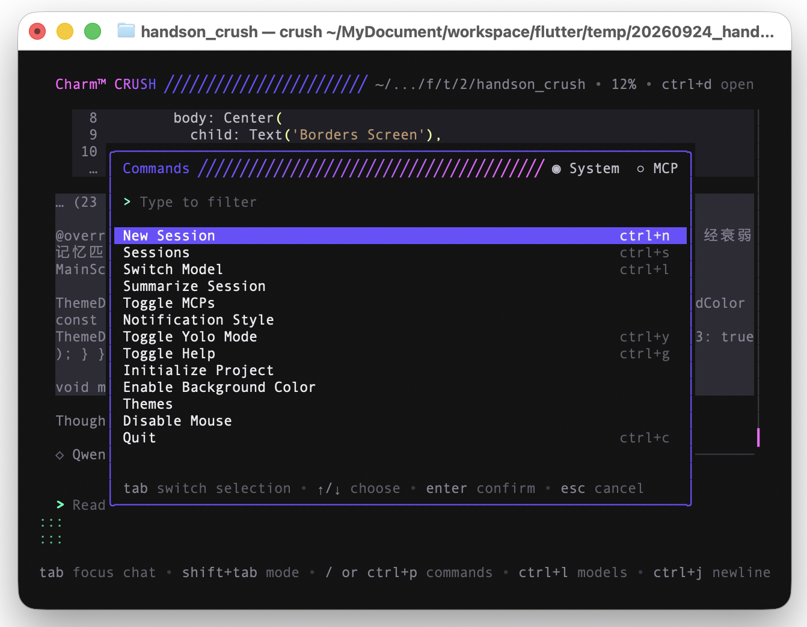  
  `/` 打鍵でメニュー一覧がポップアップします。

- step.4  
  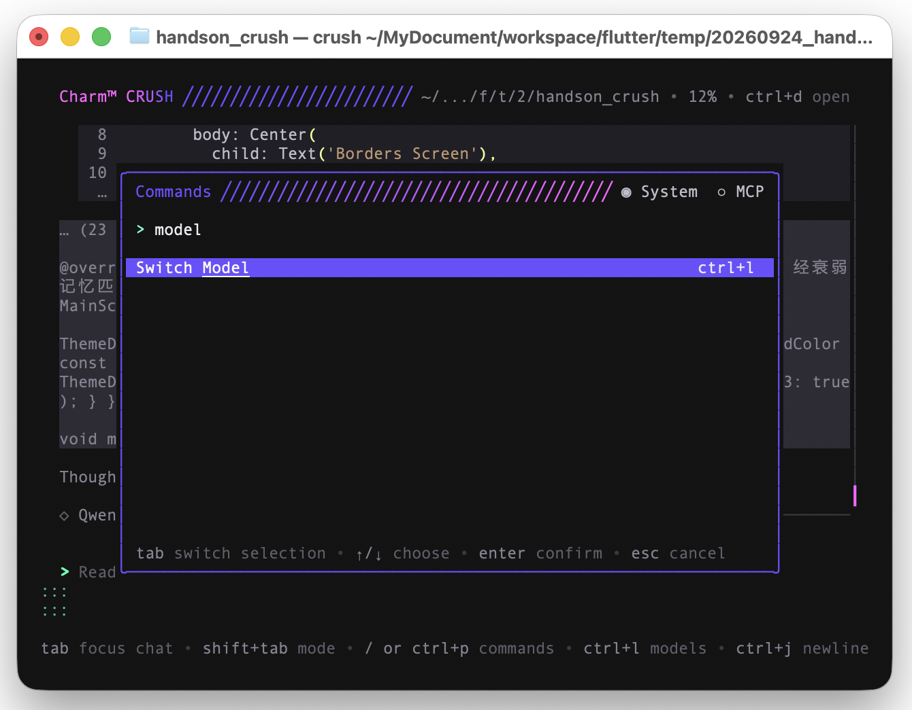  
  続けて `model` と打鍵して Model メニューを選択します。

- step.5  
  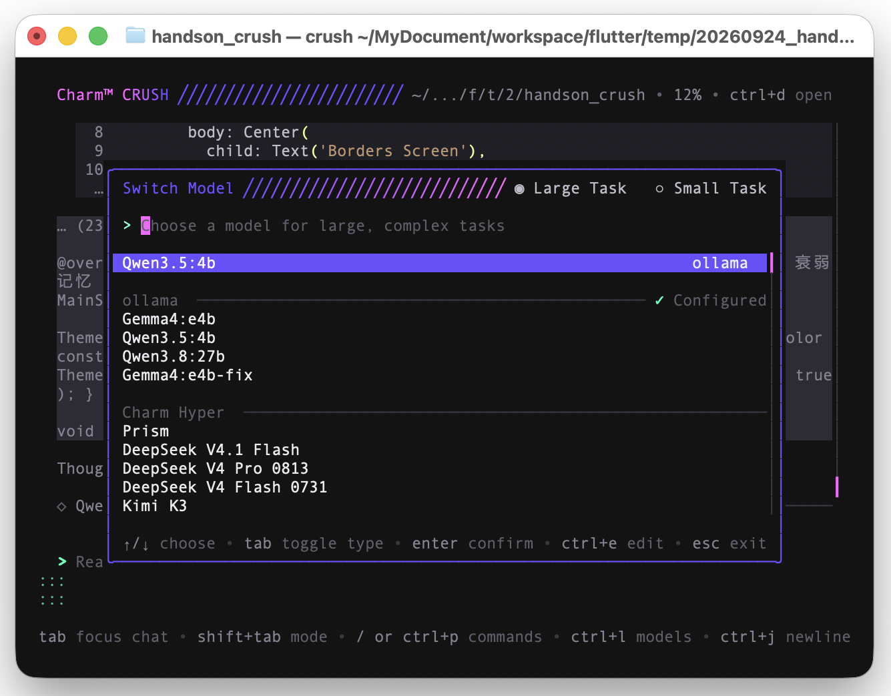  
  モデル一覧から `Qwen3.5:4b` を選択してください。

- step.6  
  以下のプロンプトを Ctrl + C でコピーして、プロンプト欄に Ctrl+v で貼り付けてください。  

```
ここでのファイルの書き込みやファイル一覧の取得は、ツールを介して行います。
このため利用可能なツール名の一覧を出力して、ツールを確認しておいてください。

カレントディレクトリは、Flutter プロジェクトのルートディレクトリです。
神経衰弱ゲームアプリのコードをを作って、プロジェクトを完成させるのがゴールです。

ファイル書き込みや読み出しは、ツールに依頼します。
タスクが負荷のため停止させられたら、作業を分割してもう一度繰り返してください。
ツールにファイルを書き込みをさせたら`flutter analyze <ファイルパス>` コマンドを実行してエラーがないことを検証してください。
検証によりファイルのコードにエラーがあれば、エラー指摘の行を１つ選び、指摘内容に従ってエラーのあるファイルのコードを修正して、ツールに修正コードのファイルへの書き込みを依頼します。

コードの作成とファイル書き込みと検証と修正を繰り返し、コードからエラーをなくして、プロジェクトを完成させてください。”
```

#### ユーザーへの承認が出た場合

Antigravity と同じように、ツールの実行やファイルの変更に対してユーザ承認が求められます。

- step.7  
  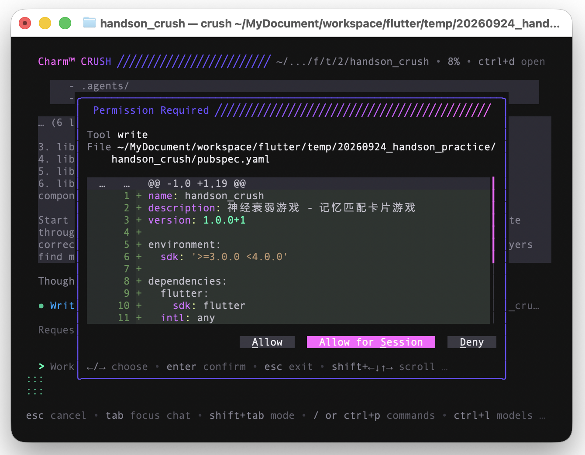  
  Antigravity のときと同じ様に `Allow for Session` を選択します。

- step.8  
  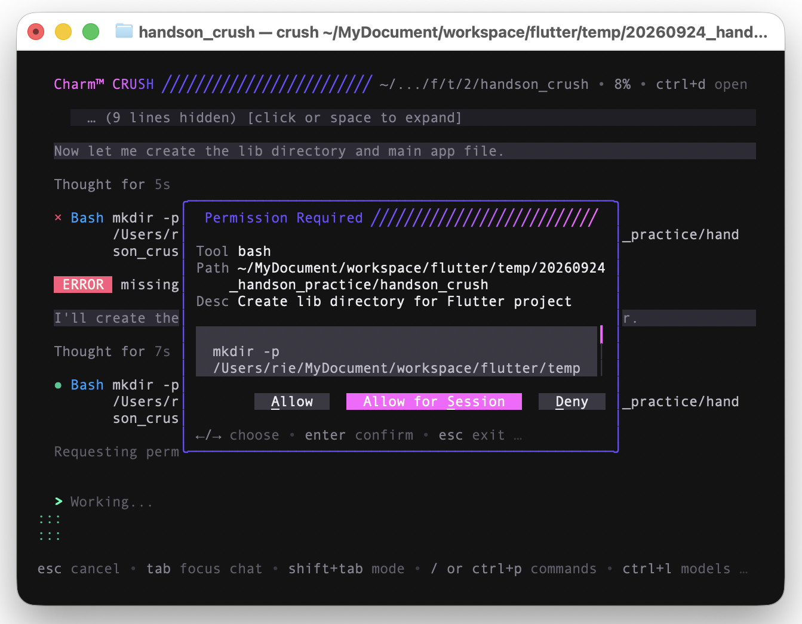  
  Antigravity のときと同じ様に `Allow for Session` を選択します。


#### ローカル LLM と Coding Agent Harness を使ったアプリ開発の限界

ローカル LLM は、フロンティアモデルに比べて圧倒的に非力なので、処理に時間もかかりますしプロジェクトを完成させることができないとも思います。

ですがサブスク課金やトークン消費を気にせずに使えるので、一度使ってみてください。

---

Ollama を単独で利用するガイドも作りましたので、よろしければ御一読ください。

- Webコンテンツ版: [Ollama ガイド（簡易版）](./Ollama_guide.html)

- リポジトリ版: [Ollama ガイド（簡易版）](./Ollama_guide.md)

---
---

## むすび

これにて DevFest Kyoto 2026 - 東京出張所 ワークショップは終了といたいします。

フロンティアモデルによる AI コーディングは、実用の域を超え始めたことを感じていただき、

ローカル LLM と ローカル AI coding agent harness の進化について感じていただければ幸いです。


